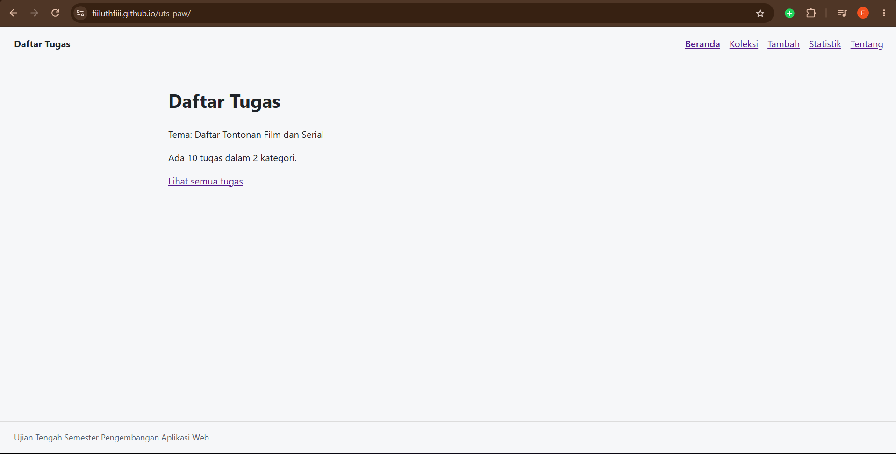
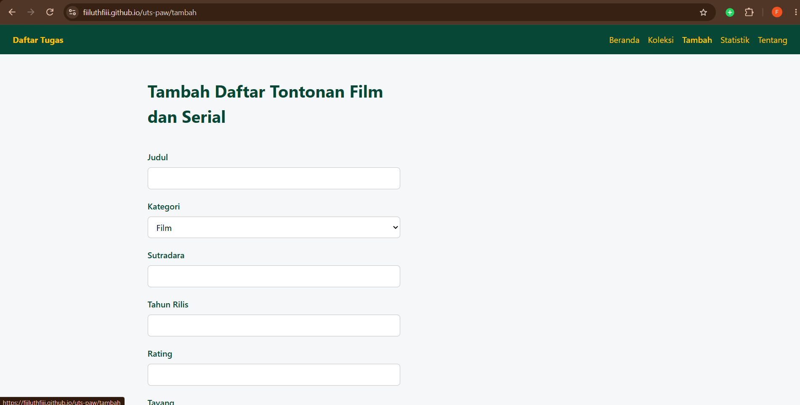
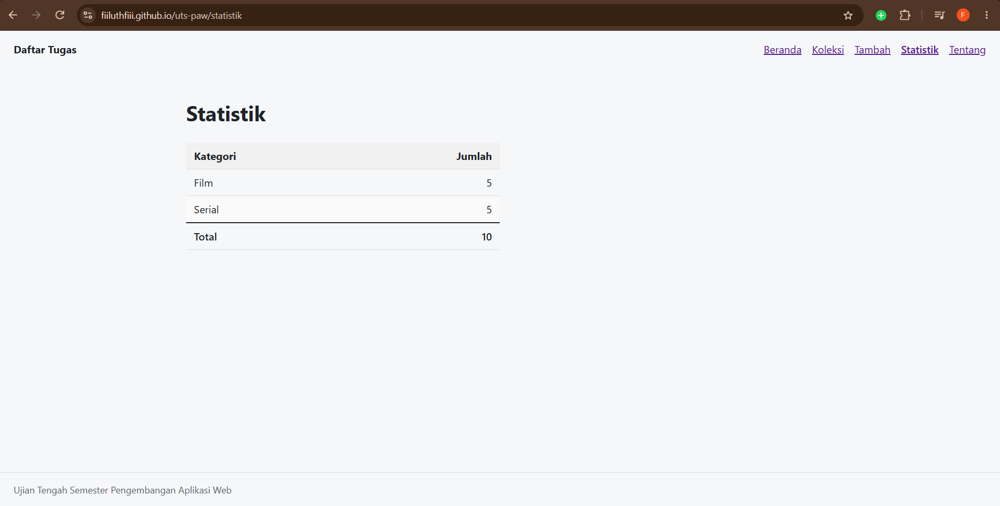
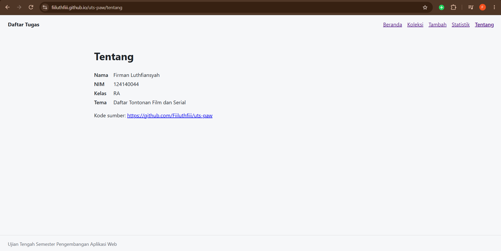
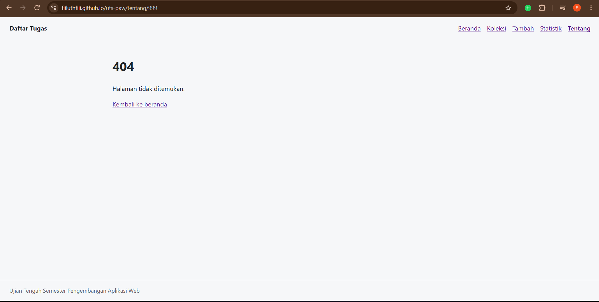

# Nama Aplikasi

Nama: Firman Luthfiansyah
NIM: 124140044
Kelas: RA
Tema: Daftar Tontonan Film dan Serial
Deployment: https://github.com/Fiiluthfiii/uts-paw 








## Fitur

1. Halaman Beranda
- Menampilkan judul aplikasi Daftar Tugas.
- Menampilkan tema aplikasi.
- Menampilkan jumlah seluruh data tontonan.
- Menampilkan jumlah kategori yang tersedia.
- Menyediakan tombol Lihat semua tugas menuju halaman Koleksi.
- Menampilkan status pemuatan data saat data sedang dimuat.
2. Halaman Koleksi
- Menampilkan seluruh data film dan serial.
- Menampilkan informasi:
  - Judul
  - Kategori
  - Sutradara
  - Tahun rilis
  - Rating
  - Tanggal tayang
- Menyediakan fitur pencarian berdasarkan judul.
- Menyediakan filter berdasarkan kategori Film atau Serial.
3. Halaman Detail
- Menampilkan informasi lengkap dari film atau serial yang dipilih.
- Menampilkan judul, kategori, sutradara, tahun rilis, rating, dan tanggal tayang.
- Menyediakan tombol Hapus untuk menghapus data.
4. Halaman Tambah
- Menambahkan data film atau serial baru.
- Menyediakan input:
  - Judul
  - Kategori
  - Sutradara
  - Tahun rilis
  - Rating
  - Tanggal tayang
- Menyediakan validasi judul minimal tiga karakter.
- Menampilkan pesan kesalahan jika judul belum valid.
5. Halaman Statistik
- Menampilkan jumlah tontonan berdasarkan kategori.
- Menampilkan jumlah Film.
- Menampilkan jumlah Serial.
- Menampilkan total seluruh data tontonan dalam koleksi.
6. Halaman Tentang
- Menampilkan identitas mahasiswa:
  - Nama
  - NIM
  - Kelas
  - Tema aplikasi
- Menampilkan tautan menuju repository GitHub project.
- Menampilkan tautan menuju Website Portfolio Saya.
7. Halaman 404
- Menyediakan halaman 404 untuk alamat yang tidak ditemukan.

## Menjalankan secara lokal

cd app
npm install
npm run dev

## Konsep React yang dipakai

Konsep React yang Dipakai
- Component-Based Architecture
  Aplikasi dibagi menjadi beberapa komponen seperti Layout, Koleksi, Detail, Tambah, Statistik, dan Tentang.
- JSX
  Digunakan untuk menulis struktur tampilan HTML di dalam JavaScript.
- Props
  Digunakan untuk mengirim data dari komponen induk ke komponen anak, contohnya data item pada komponen KartuItem.
- State dengan useState
  Digunakan untuk menyimpan data yang dapat berubah, seperti:
  - Isi pencarian
  - Kategori yang dipilih
  - Data formulir tambah
  - Pesan kesalahan
- Side Effect dengan useEffect
  Digunakan untuk mengambil data dari koleksi.json dan menyimpan perubahan data ke localStorage.
- Context API
  KoleksiProvider digunakan untuk menyediakan data koleksi dan fungsi tambah/hapus ke berbagai halaman tanpa mengirim props secara manual.
- React Router
  Digunakan untuk membuat navigasi antarhalaman, seperti:
  - /
  - /koleksi
  - /koleksi/:id
  - /tambah
  - /statistik
  - /tentang
- Dynamic Route
  Route /koleksi/:id digunakan untuk menampilkan detail berdasarkan ID item yang dipilih.
- Event Handling
  Digunakan untuk menangani aksi pengguna seperti pencarian, perubahan formulir, penyimpanan data, dan penghapusan data.
- Pengelolaan Data Lokal
  Data disimpan menggunakan localStorage agar tetap tersedia setelah halaman dimuat ulang.
- Pengambilan Data Asinkron
  Fungsi fetch() digunakan untuk mengambil data awal dari file public/data/koleksi.json.
```
